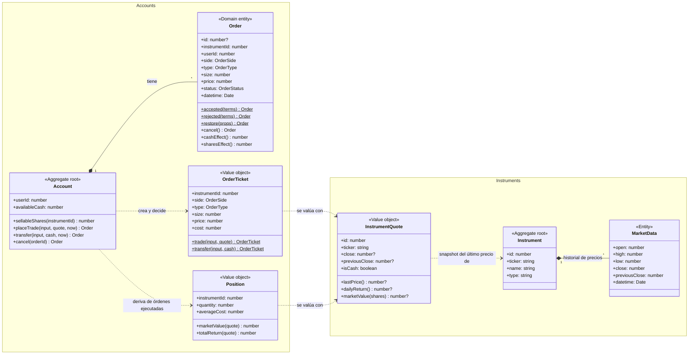
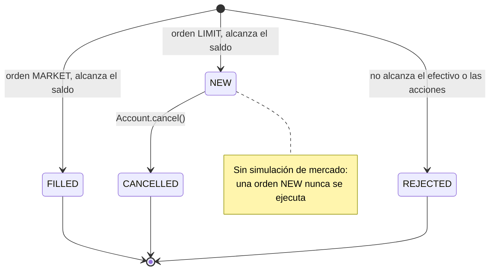

# Cocos Challenge — API de trading

Una API en NestJS + PostgreSQL para buscar instrumentos, enviar y cancelar órdenes, ingresar y retirar dinero, y consultar el portfolio de una cuenta.

## Cómo levantarlo

Requiere Node 24 y Docker.

```bash
npm install
npm run db:up            # Postgres: dev en :5432, test en :5433, ambos cargados desde db/init/database.sql
npm run migration:run    # una vez por cada db:up — los contenedores corren sobre tmpfs, así que los datos no sobreviven a un reinicio
npm run start:dev        # http://localhost:3000, documentación de la API en http://localhost:3000/docs
```

### Entornos

Los scripts `start*` y `migration:*` definen un `APP_ENV` por defecto (`dev`, o `prod` para `start:prod`); se puede sobrescribir en la misma línea, por ejemplo `APP_ENV=prod npm run migration:run`. Si `APP_ENV` falta o es desconocido, la app no arranca. Los tests siempre usan `test`, y ahí los archivos tienen prioridad sobre el shell, así que un `DATABASE_URL` exportado no puede apuntar la suite a otra base de datos.

### Tests

```bash
npm run test:unit        # tests unitarios de dominio y HTTP
npm run test:feature     # escenarios Gherkin (test/features) contra la app y la base de test
npm run test:cov         # todo, con cobertura de src/
```

Pruebas manuales: importar `postman/cocos-challenge.postman_collection.json`.

## API

| Método | Ruta | |
|---|---|---|
| `GET` | `/instruments?ticker=&name=&limit=&offset=` | Busca instrumentos con su última cotización |
| `POST` | `/orders` | Envía una orden: `BUY`, `SELL`, `CASH_IN`, `CASH_OUT` |
| `GET` | `/orders/:id` | Una orden |
| `PATCH` | `/orders/:id/cancel` | Cancela una orden `NEW` |
| `POST` | `/users` | Crea un usuario |
| `GET` | `/users/:id/orders?limit=&offset=` | Las órdenes de un usuario, de la más antigua a la más reciente |
| `GET` | `/users/:id/portfolio` | Valor total, efectivo disponible y posiciones |
| `POST` | `/instruments`, `/instruments/:id/marketdata` | Datos de referencia: solo en dev y test (ver más abajo) |

La documentación OpenAPI se sirve en `/docs` (el JSON en `/docs-json`).

Los listados se paginan con `limit` (1–100, por defecto 50) y `offset` (por defecto 0), y responden `{ items, total, limit, offset }`, donde `total` cuenta todos los resultados.

Errores: 
`400` request mal formado (los bodies y las queries se validan contra los DTOs), 
`404` usuario, orden o instrumento inexistente, 
`409` orden no cancelable, 
`422` una orden bien formada que el dominio rechaza (por ejemplo, operar el instrumento de efectivo).

# Diseño

## Modelo de dominio

Dos bounded contexts. 
**Accounts** es dueño de todo lo que hace un usuario: enviar órdenes,
cancelarlas y mantener posiciones. 
**Instruments** es dueño de lo que se opera y de sus precios.
Accounts lee los precios de los instrumentos como snapshots `InstrumentQuote` y nunca los modifica.



## Ciclo de vida de una orden



Solo las órdenes NEW se pueden cancelar; cancelar cualquier otra responde 409. Los requests
mal formados se rechazan con 400 o 422 antes de que exista una orden, así que nunca aparecen
en este ciclo de vida.

# Supuestos

**Órdenes**
- Las transferencias de efectivo son órdenes sobre el instrumento `ARS` (tipo `MONEDA`): `CASH_IN` / `CASH_OUT`, con `size` en pesos enteros (la columna `size` es un entero) y precio 1. Siempre son `MARKET` y se ejecutan en el momento.
- Las órdenes `MARKET` se ejecutan inmediatamente al último cierre del instrumento; cualquier `price` enviado se ignora. Un instrumento sin cierre no se puede operar a mercado.
- Las órdenes `LIMIT` se guardan como `NEW` y quedan así: no hay motor de matching. Mientras están en `NEW`, una compra reserva `size × price` de efectivo y una venta reserva sus acciones.
- Una orden indica su cantidad como `size` (acciones enteras) o `budget` (pesos), nunca ambos. Un budget compra la mayor cantidad de acciones enteras que cubre (`floor(budget / price)`, calculado en centavos); no hay acciones fraccionarias.
- Los precios y budgets tienen como máximo 2 decimales, como las columnas `NUMERIC(10,2)`: cualquier valor más fino es un `400`, nunca se redondea en silencio.
- Una orden que la cuenta no puede afrontar — efectivo insuficiente, acciones insuficientes o un budget menor a una acción — se guarda como `REJECTED` y se responde con `201`: un rechazo es un resultado, no un error.
- Solo las órdenes `NEW` se pueden cancelar. Cancelar libera lo que tenían reservado.
- No hay comisiones, impuestos, horario de mercado ni plazo de liquidación: una orden ejecutada afecta el efectivo y las posiciones de inmediato.

**Posiciones y rendimientos**
- El costo usa el costo promedio ponderado: las compras suben la base de costo, las ventas quitan acciones al costo promedio vigente (el promedio no cambia) y vender todo lo reinicia. Una venta parcial toma su parte de la base de costo redondeada al centavo; `averageCost` en sí se informa sin redondear (por ejemplo, `333.333…`).
- `totalReturn` compara el valor de mercado con la base de costo; `dailyReturn` compara el último cierre con el cierre anterior. Ambos son porcentajes redondeados a 2 decimales (`2.27` = 2,27%); el dominio los guarda como ratios.
- Las posiciones se listan por ticker.

**Instrumentos**
- `ticker` y `name` son filtros opcionales, parciales e insensibles a mayúsculas; si se envían ambos, tienen que coincidir los dos. Los filtros vacíos se ignoran, `%` y `_` se buscan literalmente, y los resultados se ordenan por ticker y se paginan.

**Datos**
- Se respeto la nomenclatura dada en el enunciado (camelCase), que difiere del seed y la base que se compartió (lowercase).
- Se encontro que los datos del seed generaban un caso de error, asi que se alteró para que quede un caso sin error.

**Alcance**
- No hay autenticación: el usuario se identifica por el `userId` del request.
- `POST /users` es un alta mínima: un email y un número de cuenta, sin perfil ni validaciones de unicidad.
- `POST /instruments` y `POST /instruments/:id/marketdata` existen para preparar tests y datos locales. Solo se registran cuando `ENABLE_REFERENCE_DATA_ENDPOINTS=true`, y la app se niega a arrancar con eso en `prod`.
